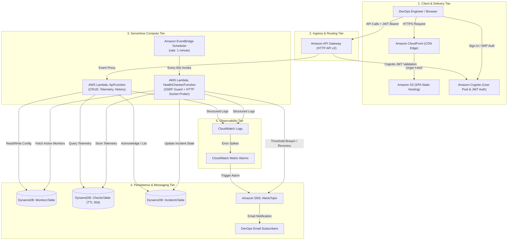
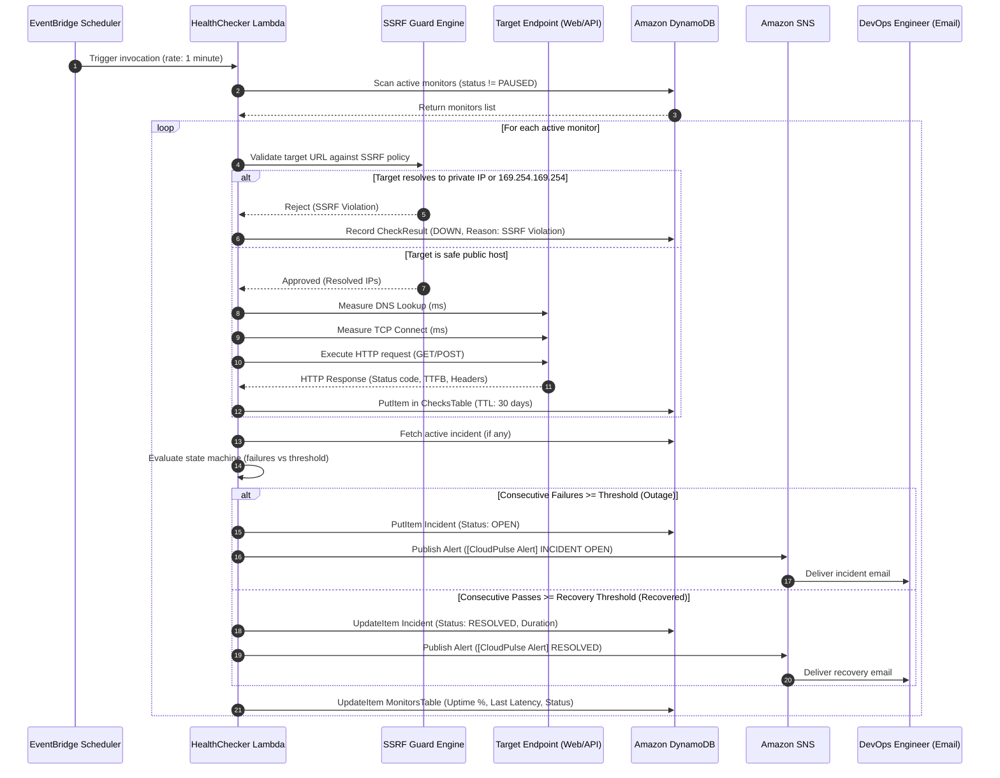

# CloudPulse — System Architecture & Technical Design

CloudPulse is a production-grade, serverless website and API uptime monitoring and incident alerting platform built on Amazon Web Services (AWS). It continuously probes distributed HTTP/HTTPS endpoints, collects high-resolution socket latency telemetry (DNS, TCP, TTFB), evaluates incident transitions through a state machine, and publishes multi-channel alert notifications via Amazon SNS.

---

## 1. High-Level Architecture Diagram

---

## 2. Telemetry & Probe Execution Flow

---

## 3. Key Architectural Decisions & Trade-Offs

### 3.1. AWS Lambda vs. Containerized Services (ECS / EC2)
- **Choice**: Serverless AWS Lambda.
- **Rationale**: An uptime monitor's workload is naturally episodic: health checks execute every minute and complete in 1–3 seconds. Running dedicated EC2 instances or ECS tasks incurs 24/7 idle server costs. Lambda executes on-demand, scales horizontally with zero capacity management, and falls comfortably within the AWS Free Tier (1 million free requests/month).

### 3.2. EventBridge Scheduler vs. Traditional Cron / Celery
- **Choice**: Amazon EventBridge Scheduler.
- **Rationale**: Traditional cron setups require persistent servers and introduce single points of failure (SPOF). EventBridge Scheduler is fully managed, highly available across multiple Availability Zones, supports automated retry policies with Dead-Letter Queues (DLQ), and invokes Lambda functions with millisecond accuracy.

### 3.3. Amazon DynamoDB vs. Relational RDS
- **Choice**: Amazon DynamoDB (On-Demand Capacity).
- **Rationale**: Uptime checks generate high-write, predictable key-value telemetry. DynamoDB delivers single-digit millisecond latency, scales seamlessly without connection pool bottlenecks, and provides native **Time to Live (TTL)** which automatically deletes historical checks older than 30 days without scheduled cron cleanup scripts or storage bloat.

### 3.4. Amazon Cognito vs. Self-Hosted Authentication
- **Choice**: Amazon Cognito User Pool + JWT Authorizer.
- **Rationale**: Cognito offloads password hashing (SRP protocol), token signing (RS256), email verification, and session management. API Gateway validates Cognito JWT tokens at the ingress boundary *before* invoking Lambda, protecting backend compute from unauthorized requests and Denial of Service (DoS) attacks.

---

## 4. Defense-in-Depth Security Model

1. **Strict SSRF Defense**:
   - Outgoing probe URLs are resolved to their target IP addresses using DNS before connection establishment.
   - Any address falling within private RFC 1918 blocks (`10.0.0.0/8`, `172.16.0.0/12`, `192.168.0.0/16`), loopback (`127.0.0.0/8`, `::1`), link-local (`169.254.0.0/16`), or AWS IMDS (`169.254.169.254`) is immediately aborted.
   - Redirect chains are intercepted (`SafeRedirectSession`); each subsequent redirect target is independently validated against the SSRF blocklist before the hop is made.
2. **Least-Privilege IAM Execution Roles**:
   - Lambda functions are granted only the precise IAM actions needed (`dynamodb:PutItem`, `dynamodb:GetItem`, `dynamodb:Query`, `sns:Publish`) scoped strictly to the specific resource ARNs created by the CloudFormation stack.
3. **Encrypted Ingress & Storage**:
   - S3 static assets are strictly private; public direct access is disabled via S3 Block Public Access. Only Amazon CloudFront via Origin Access Control (OAC) can read website objects.
   - DynamoDB tables utilize AWS-managed encryption at rest (KMS).
   - In-transit communication is exclusively TLS 1.3 / HTTPS.
