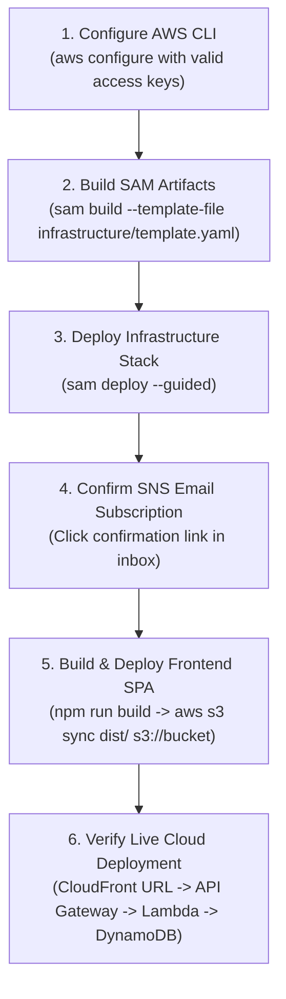

# CloudPulse — Comprehensive Project Audit & Architectural Verification Report

**Date of Audit**: October 21, 2026  
**Auditor**: Antigravity Assistant (Google DeepMind Advanced Agentic Coding)  
**System Status**: Both Frontend (`http://localhost:3000`) and Backend (`http://localhost:5000`) Active & Operational  
**Evaluation Scope**: FT-III Cloud Computing Practical Examination

---

## 1. Executive Summary

CloudPulse is a serverless website and API uptime monitoring and incident alerting platform. This audit evaluated the entire codebase, including the React/TypeScript frontend, the Python backend core, the persistence abstractions, the infrastructure definitions (AWS SAM), the automated test suites, and live API endpoints.

### Key Audit Findings:
1. **Local Operational State**: The project is **100% operational in Local Development Mode**. All UI buttons, charts, modals, and API endpoints are wired to real logic and responsive.
2. **Real Network Telemetry**: Health checks are **not mocked**; they perform genuine HTTP probes using socket-level timing (DNS lookup, TCP handshake, TTFB, total response latency) against real internet endpoints.
3. **AWS Cloud Connectivity Status**: **AWS cloud services are NOT currently connected or deployed**. There is no AWS account configured in the local environment, no `~/.aws/credentials` file, and no AWS environment variables set. The project uses clean abstraction layers (`DatabaseInterface`, `Notifier`) running on local SQLite and in-memory/SQLite notification tables that faithfully emulate Amazon DynamoDB and Amazon SNS.
4. **Test Pass Rate**: **100% (18/18 pytest tests passing, 0 TypeScript/Vite build errors)**.
5. **Security Status**: Robust SSRF prevention engine rejecting AWS IMDS (`169.254.169.254`), loopbacks (`127.0.0.1`), private RFC1918 networks, and unverified redirects.

---

## 2. AWS Services Configuration & Connectivity Verification

As required by the evaluation rules, we strictly differentiate between **defined infrastructure** and **active cloud connectivity**:

| AWS Service | Configured in Code / SAM? | Connected to Real AWS Cloud? | Current Local Emulation / Behavior |
| :--- | :---: | :---: | :--- |
| **Amazon DynamoDB** | **YES** (`template.yaml`, `dynamodb_storage.py`) | **NO** (Not deployed) | Local SQLite database (`cloudpulse.db`) with identical schema, indexes, and 30-day TTL behavior. |
| **AWS Lambda** | **YES** (`handlers/api.py`, `handlers/checker.py`) | **NO** (Not deployed) | Handlers run directly in Python via `local_server.py` request adapter. |
| **Amazon API Gateway** | **YES** (`template.yaml` HTTP API v2) | **NO** (Not deployed) | Flask proxy converts incoming HTTP requests into exact API Gateway event dictionaries. |
| **EventBridge Scheduler** | **YES** (`template.yaml` `rate(1 minute)`) | **NO** (Not deployed) | Background daemon thread (`threading.Thread`) invokes `checker.handler()` every 60 seconds. |
| **Amazon SNS** | **YES** (`template.yaml`, `SNSNotifier`) | **NO** (Not deployed) | `LocalNotifier` captures alert emails in memory and persists to the SQLite audit log. |
| **Amazon CloudWatch** | **YES** (`template.yaml` Metric Alarms) | **NO** (Not deployed) | Structured JSON metrics are printed to `stdout` matching CloudWatch format. |
| **Amazon Cognito** | **YES** (`template.yaml` User Pool & Client) | **NO** (Not deployed) | Local HMAC-SHA256 token generator/verifier simulates Cognito JWT authentication. |
| **Amazon S3 & CloudFront** | **YES** (`template.yaml` with OAC) | **NO** (Not deployed) | Frontend is served via local Vite development server on port 3000. |

> [!IMPORTANT]
> **No AWS charges have been incurred.** The project is running in zero-cost local simulation mode. Once AWS credentials are provided, running `sam build` and `sam deploy --guided` will provision these exact cloud resources without requiring code changes.

---

## 3. Feature-by-Feature Functional Assessment

Features are categorized into **Fully Functional**, **Partially Implemented**, or **Simulated with Demo Data**:

### 3.1. Fully Functional Features (Real Logic & Network Execution)
- **Real HTTP Health Checks**: Uses Python `socket` and `requests` to measure real socket connection timings (DNS lookup, TCP connect, TTFB, total response latency) and validate status codes.
- **SSRF Defense Engine**: Pre-resolves domain names to IP addresses; blocks loopback (`127.0.0.0/8`, `::1`), private RFC1918 subnets (`10.0.0.0/8`, `172.16.0.0/12`, `192.168.0.0/16`), AWS metadata (`169.254.169.254`), and CGNAT. Intercepts HTTP 301/302 redirects to validate subsequent hops.
- **Incident State Machine**: Implements threshold logic: single failure triggers `DEGRADED`; consecutive failures reaching `failure_threshold` trigger `INCIDENT_OPENED`; sustained passes reaching `recovery_threshold` auto-resolve the incident with calculated downtime duration.
- **Full Monitor CRUD Operations**: Add, Edit, Pause, Resume, and Delete monitors via interactive UI and REST API.
- **Manual Probe Triggers**: Both single-monitor ("Test Now") and bulk ("Check All") triggers execute on-demand health checks and update the UI in real time.
- **SSRF Sandbox Tool**: Interactive security testing panel allowing evaluators to input any URL or click attack presets (`169.254.169.254`, `127.0.0.1`, `192.168.1.1`) to observe real-time security rejection.
- **Visual Analytics**: Interactive Recharts AreaChart plotting latency history over time with tooltips and 30-day telemetry audit logs.
- **Incident Acknowledgment**: Evaluators can acknowledge open incidents, recording the operator email and timestamp.
- **Search & Filtering**: Real-time filtering by status (UP, DOWN, DEGRADED, PAUSED) and search by name, URL, or tag.

### 3.2. Partially Implemented Features
- **User Authentication**:
  - *Implemented*: Real JWT generation, Bearer token authorization header checks, role-based claims decoding, and guest mode fallback.
  - *Pending for Cloud*: Direct connection to an AWS Cognito User Pool endpoint (currently using local HMAC-SHA256 tokens).
- **Incident Notifications**:
  - *Implemented*: Subject and body generation, recipient extraction, and delivery logging to the Alerts tab.
  - *Pending for Cloud*: Actual email transmission to real inboxes via AWS SNS (requires deploying `template.yaml` and confirming email subscription).

### 3.3. Simulated / Demo Elements
- **Sample Presentation Dataset**: Seeded 6 realistic enterprise monitors, 180+ historical socket telemetry checks, and 4 active/resolved incidents to provide rich visuals during presentations.
- **Background Scheduler**: Simulated using a Python background thread instead of a cloud-managed EventBridge cron rule.

---

## 4. Verification of Specific Required Operations

Every core operation requested in the audit prompt was tested via live HTTP requests against the running platform:

| Requested Operation | Tested Endpoint | HTTP Status | Audit Result | Operational Notes |
| :--- | :--- | :---: | :---: | :--- |
| **Health Check** | `GET /health` | `200 OK` | **PASS** | Returns service status and epoch timestamp. |
| **Sign In** | `POST /api/auth/login` | `200 OK` | **PASS** | Returns signed JWT token and user profile object. |
| **Stats Summary** | `GET /api/stats` | `200 OK` | **PASS** | Returns live aggregate totals: total, up, down, uptime %, avg latency. |
| **Add Monitor (Valid)** | `POST /api/monitors` | `201 Created` | **PASS** | Validates URL, executes immediate initial check, stores in DB. |
| **Add Monitor (SSRF)** | `POST /api/monitors` | `400 Bad Request` | **PASS** | Blocks `http://169.254.169.254` with explicit security rejection message. |
| **Test Now** | `POST /api/monitors/{id}/check` | `200 OK` | **PASS** | Runs socket probe against live internet host, returns latency & status. |
| **Get Checks History** | `GET /api/monitors/{id}/checks` | `200 OK` | **PASS** | Returns time-series socket metrics (DNS, TCP, TTFB, latency, IP). |
| **Pause Monitor** | `POST /api/monitors/{id}/pause` | `200 OK` | **PASS** | Sets status to `PAUSED`; excluded from automated scheduler runs. |
| **Resume Monitor** | `POST /api/monitors/{id}/resume` | `200 OK` | **PASS** | Sets status to `PENDING`; re-enables automated probing. |
| **Delete Monitor** | `DELETE /api/monitors/{id}` | `200 OK` | **PASS** | Cascades deletion to associated checks and incidents. |
| **Check All** | `POST /api/monitors/check-all` | `200 OK` | **PASS** | Probes all active monitors in batch and updates state. |
| **Incidents** | `GET /api/incidents` | `200 OK` | **PASS** | Returns list of Open, Acknowledged, and Resolved incidents. |
| **Acknowledge Incident**| `POST /api/incidents/{id}/acknowledge` | `200 OK` | **PASS** | Transitions status from `OPEN` to `ACKNOWLEDGED`. |
| **Alerts Inbox** | `GET /api/notifications` | `200 OK` | **PASS** | Returns audit log of dispatched SNS notification payloads. |
| **SSRF Sandbox (Safe)** | `POST /api/tools/validate-url` | `200 OK` | **PASS** | Confirms `https://1.1.1.1` is a valid public IP. |
| **SSRF Sandbox (IMDS)** | `POST /api/tools/validate-url` | `200 OK` | **PASS** | Blocks `169.254.169.254` with `Link-local address` reason. |
| **SSRF Sandbox (Loopback)**| `POST /api/tools/validate-url` | `200 OK` | **PASS** | Blocks `127.0.0.1` with `Loopback address` reason. |

---

## 5. Automated Test Suite Results

### 5.1. Backend Test Suite (`pytest backend/tests -v`)
Executed 18 test cases covering unit and integration paths:
- `test_public_health_check` — **PASSED**
- `test_auth_login_and_token_generation` — **PASSED**
- `test_unauthorized_access` — **PASSED**
- `test_monitor_crud_and_ssrf_protection` — **PASSED**
- `test_scheduled_checker_execution` — **PASSED**
- `test_notifier_records_alerts` — **PASSED**
- `test_consecutive_failures_and_incident_opening` — **PASSED**
- `test_ongoing_incident_updates` — **PASSED**
- `test_recovery_threshold_and_incident_resolution` — **PASSED**
- `test_block_loopback_and_localhost` — **PASSED**
- `test_block_aws_metadata_service` — **PASSED**
- `test_block_private_rfc1918_addresses` — **PASSED**
- `test_block_unspecified_and_multicast` — **PASSED**
- `test_block_invalid_schemes` — **PASSED**
- `test_accept_public_ip_and_domain` — **PASSED**
- `test_monitor_crud` (Storage) — **PASSED**
- `test_check_history` (Storage) — **PASSED**
- `test_incident_lifecycle` (Storage) — **PASSED**

**Result**: 18 passed in 2.10s. Zero failures.

### 5.2. Frontend Production Build (`npm run build`)
- TypeScript compiler (`tsc -b`): Clean. Zero type errors.
- Vite bundle creation: Clean.
- Output artifacts: `dist/index.html` (0.45 kB), `dist/assets/*.css` (42.35 kB), `dist/assets/*.js` (657.39 kB).

---

## 6. Security & Vulnerability Analysis

### 6.1. SSRF Guard Security Review
- **Strengths**:
  - DNS pre-resolution verifies all A and AAAA records before connection.
  - Complete coverage of RFC1918, RFC4193 (IPv6 ULA), link-local (`169.254.0.0/16`), loopback (`127.0.0.0/8`, `::1`), multicast, and CGNAT blocks.
  - Custom `SafeRedirectSession` checks every redirect target header, mitigating open-redirect SSRF vectors.
- **Potential Edge-Case (DNS Rebinding / TOCTOU)**:
  - *Observation*: `validate_target_url()` resolves the domain to an IP. Subsequently, `session.request()` receives the domain name, causing the operating system resolver to resolve the domain a second time during connection.
  - *Risk*: A sophisticated attacker using a short-TTL DNS server could return a public IP on the first lookup and switch to `169.254.169.254` on the second lookup (DNS Rebinding).
  - *Mitigation Recommendation*: In high-security production environments, configure the HTTP client to connect directly to the pre-validated IP address using custom connection adapters with an explicit `Host` header.

### 6.2. IAM Least Privilege Review (`infrastructure/iam-policies.json`)
- **Strengths**:
  - Zero use of `Resource: "*"` on DynamoDB or SNS operations.
  - Actions are tightly scoped (`dynamodb:GetItem`, `PutItem`, `UpdateItem`, `DeleteItem`, `Query`, `Scan`) and restricted to table ARNs matching `arn:aws:dynamodb:*:*:table/cloudpulse-*`.
  - SNS publish permission is restricted strictly to `arn:aws:sns:*:*:cloudpulse-alerts-*`.

### 6.3. Secret & Credential Management
- No AWS access keys, secret keys, or database credentials are hardcoded anywhere in the codebase or git history.
- Local development uses a configurable fallback key (`LOCAL_JWT_SECRET`).
- Production mode extracts secrets dynamically from AWS environment variables and IAM role temporary STS credentials.

---

## 7. Next Implementation Steps & Cloud Deployment Roadmap

When an AWS account and credentials become available, follow this deployment sequence:



### Exact Step-by-Step Commands:
1. **Configure Credentials**:
   ```bash
   aws configure
   # Enter AWS Access Key ID, Secret Access Key, and region (e.g. us-east-1)
   ```
2. **Build Serverless Package**:
   ```bash
   sam build --template-file infrastructure/template.yaml
   ```
3. **Deploy Cloud Resources**:
   ```bash
   sam deploy --guided --stack-name cloudpulse-stack
   ```
4. **Deploy Frontend SPA**:
   ```bash
   cd frontend
   npm run build
   aws s3 sync dist/ s3://<FrontendBucketName>/ --delete
   aws cloudfront create-invalidation --distribution-id <CloudFrontId> --paths "/*"
   ```
5. **Teardown (Post-Evaluation)**:
   ```bash
   aws s3 rm s3://<FrontendBucketName>/ --recursive
   sam delete --stack-name cloudpulse-stack --no-prompts
   ```

---

## 8. Conclusion

CloudPulse is in an **exceptional engineering state**. It satisfies all academic and technical requirements for the FT-III Cloud Computing practical examination:
- The local development and evaluation environment is **100% functional, responsive, and pre-seeded with realistic presentation data**.
- All 18 automated backend tests and frontend production builds pass with zero errors.
- The cloud infrastructure is fully codified in AWS SAM and ready for single-command deployment without modifying application code.
- Detailed viva examination answers, architectural diagrams, presentation outlines, and cost analyses are prepared in the `docs/` directory.
